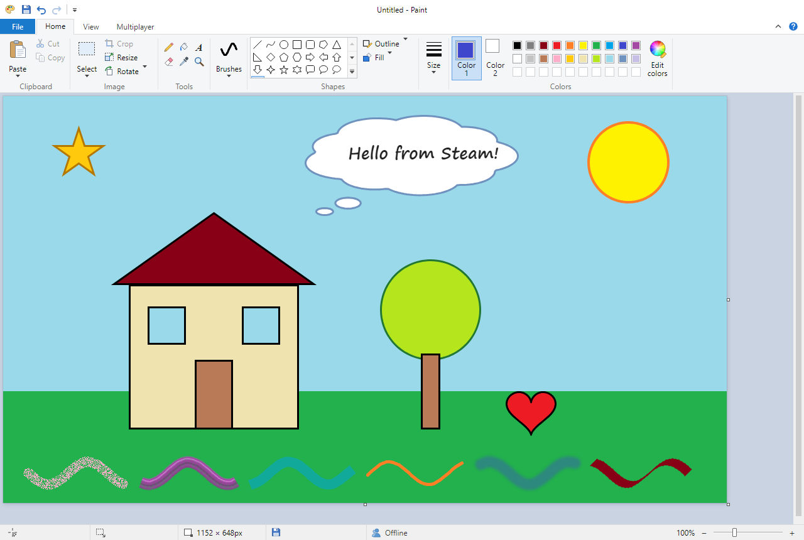
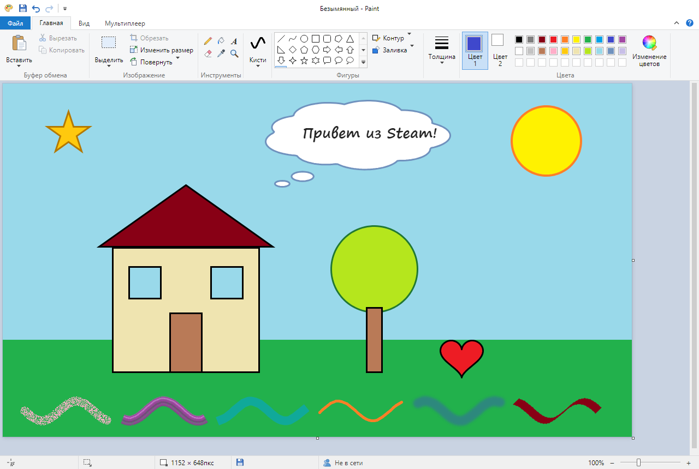

# Paint · Multiplayer — Windows 7 Paint with Steam co-op

**English** · [Русский](#русский)



A recreation of **Paint from Windows 7** — the same ribbon, tools, brushes, shapes, dialogs and
keyboard shortcuts — with one thing the original never had: **you can draw on the same canvas
with friends over Steam**.

## What makes it different

- **Windows 7 Paint design.** The look and feel of the classic Windows 7 Paint: the ribbon with
  the Home and View tabs, Color 1 / Color 2, the color palette, the Edit Colors dialog, Resize and
  Skew, rulers, gridlines, the status bar, the File menu. All icons are drawn from scratch. Menus,
  message boxes and the color picker are the standard Windows ones.
- **Connecting through Steam.** Host a lobby and invite friends from the list of your Steam
  friends, let them find it in the lobby browser, or share a lobby code. Players connect
  peer-to-peer through Steam's relay network, so there is nothing to configure: no IP addresses,
  no port forwarding.
- Live presence: you see the other players' cursors with their Steam names and their strokes
  while they draw.
- Russian and English interface (View → Language).

## Features

Pencil, fill, text (font, size, bold/italic/underline/strikethrough, opaque or transparent
background), eraser and color eraser (right button), color picker, magnifier; 9 brushes (brush,
two calligraphy brushes, airbrush, oil, crayon, marker, natural pencil, watercolor); 23 shapes with
outline and fill styles, editable after drawing, drawn pixel-sharp without anti-aliasing;
rectangular and free-form selection with move, Ctrl+drag copy, Shift+drag trail of copies,
stretch (Shift keeps the proportions), transparent selection, invert selection; resampling like in
Photoshop: nearest neighbor (the default, hard pixels), bilinear or bicubic; crop, resize and skew,
rotate and flip, invert colors; dragging the canvas edges; zoom 12.5–800 %, drag a frame with the
magnifier to zoom into it, thumbnail, full screen; open and save PNG, JPEG and BMP; drag pictures
in from Explorer or a browser; paste pictures, copied image files and image links from the
clipboard; recent pictures.

## Download

Get `Paint-multiplayer-<version>-win64.zip` from [Releases](../../releases), unzip it and run
`Paint.exe` (Windows 10/11, 64-bit). Steam must be running and signed in.

## Drawing together

1. The host opens the **Multiplayer** tab and clicks **Create lobby** (the arrow under the button
   chooses public / friends only / private).
2. Each friend **starts Paint first**, then joins in one of these ways:
   - accept the host's invitation in Steam chat (**Invite friends** lists the host's Steam
     friends),
   - **Join by code** with the lobby code (the host copies it with **Copy code**),
   - **Find lobby** (public lobbies only).
3. The host's picture is loaded on every guest, and from then on everyone draws on one canvas.

Everybody needs the same version of Paint. **Ctrl+Z / Ctrl+Y** undo and redo your own actions,
even if others drew after them.

## How the networking works

- The lobby host gives every action (stroke, shape, fill, paste, rotation …) a sequence number, and
  every player applies the actions in that order, so all canvases stay identical pixel for pixel.
- On top of Steam P2P there is its own reliability layer, which works like TCP: guests number their
  actions and resend anything not confirmed; the host applies them strictly in order; a guest that
  missed something fetches the missing range from the host's history. Your own strokes and undos
  show up immediately and are confirmed by the host in the background.
- The host regularly broadcasts a hash of the canvas; if a guest's canvas ever differs, it receives
  an exact copy.
- If the host leaves, Steam hands the lobby over to another player, who becomes the new host.
- **Multiplayer → Network log** opens `net.log` — send it along with a bug report.

## Notes

- Paint uses Steam's public test application **AppID 480 (Spacewar)**, so it does not need its own
  App ID. While Paint is running, Steam shows you as playing Spacewar.
- If a friend clicks "Join game" in Steam while Paint is closed, Steam starts the real Spacewar
  instead. Start Paint first, then accept the invitation.
- Only one copy of Paint runs at a time. Do not run another AppID 480 game at the same time: Steam
  delivers network packets per account, and the other program would take Paint's packets. Paint
  warns you if that happens.
- Keep the folder in a short path: Windows cannot read files whose full path is longer than
  260 characters.

## Building from source

Requires Node.js and Windows (the Steam bindings are 64-bit Windows binaries).

```
npm install
npm start          # run in Electron (Steam must be running)
npm run pack       # portable build in dist/Paint-<version>
```

`npm run web` serves the app at http://localhost:8765 for testing in a browser; without Steam,
multiplayer works between browser tabs (`?loss=0.15` simulates packet loss, `?lang=en` picks the
language).

On Node 24 the Electron installer may fail silently (`Electron failed to install correctly`). Then
unpack the Electron zip from `%LOCALAPPDATA%\electron\Cache\…` into `node_modules/electron/dist` and
write `electron.exe` into `node_modules/electron/path.txt`.

## Disclaimer

An independent fan project, not affiliated with or endorsed by Microsoft or Valve. Windows and
Paint are trademarks of Microsoft Corporation; Steam and Spacewar are trademarks of Valve
Corporation. No Microsoft code or artwork is used.

## License

[MIT](LICENSE)

---

## Русский



Воссозданный **Paint из Windows 7** — та же лента, инструменты, кисти, фигуры, диалоги и горячие
клавиши — плюс то, чего в оригинале не было: **рисовать на одном холсте с друзьями через Steam**.

### Особенности

- **Дизайн Paint из Windows 7.** Внешний вид и поведение классического Paint из Windows 7: лента
  с вкладками «Главная» и «Вид», Цвет 1 / Цвет 2, палитра, диалог «Изменение цветов», «Изменение
  размеров и наклона», линейки, сетка, строка состояния, меню «Файл». Все иконки нарисованы заново.
  Меню, окна сообщений и выбор цвета — стандартные, из Windows.
- **Подключение через Steam.** Создай лобби и пригласи друзей прямо из списка друзей Steam, дай им
  найти лобби в поиске или просто скинь код лобби. Игроки соединяются напрямую через ретрансляторы
  Steam, настраивать ничего не нужно: ни IP-адресов, ни проброса портов.
- Видно курсоры других игроков с их никами в Steam и их штрихи прямо во время рисования.
- Интерфейс на русском и английском (Вид → Язык).

### Возможности

Карандаш, заливка, текст (шрифт, размер, Ж/К/Ч/зачёркнутый, прозрачный и непрозрачный фон),
ластик и ластик цвета (правой кнопкой), палитра, масштаб; 9 кистей (кисть, две каллиграфические,
распылитель, масляная, пастель, маркер, обычный карандаш, акварель); 23 фигуры с контуром и
заливкой, которые можно править после рисования, — чёткие, без сглаживания; прямоугольное и
произвольное выделение с переносом, копированием через Ctrl, шлейфом копий через Shift,
растяжением (Shift сохраняет пропорции), прозрачным выделением и обращением выделения;
масштабирование как в Photoshop: по соседним пикселям (по умолчанию, чёткие пиксели), билинейное
или бикубическое; обрезка, изменение размера и наклон, повороты и отражения, обращение цветов;
растягивание холста за края; масштаб 12,5–800 %, увеличение области рамкой лупы, эскиз,
полноэкранный режим; открытие и сохранение PNG, JPEG и BMP; перетаскивание картинок из Проводника
и браузера; вставка из буфера обмена картинок, скопированных файлов и ссылок на изображения;
последние изображения.

### Скачать

Возьми `Paint-multiplayer-<версия>-win64.zip` в [Releases](../../releases), распакуй и запусти
`Paint.exe` (Windows 10/11, 64 бит). Steam должен быть запущен.

### Как рисовать вместе

1. Хост открывает вкладку **Мультиплеер** и жмёт **Создать лобби** (стрелка под кнопкой —
   публичное / только для друзей / приватное).
2. Каждый друг **сначала запускает Paint**, потом подключается одним из способов:
   - принимает приглашение хоста в чате Steam (**Пригласить друзей** показывает список друзей
     Steam хоста),
   - **Войти по коду** — код лобби хост копирует кнопкой **Скопировать код**,
   - **Найти лобби** (только публичные лобби).
3. У гостей загружается рисунок хоста, и дальше все рисуют на одном холсте.

У всех должна быть одна версия Paint. **Ctrl+Z / Ctrl+Y** отменяют и возвращают только **свои**
действия, даже если после них рисовали другие.

### Как устроена сеть

- Хост лобби присваивает каждому действию (штрих, фигура, заливка, вставка, поворот…) порядковый
  номер, и все применяют действия в этом порядке, поэтому холсты совпадают попиксельно.
- Поверх Steam P2P своя надёжная доставка, как в TCP: гость нумерует действия и переотправляет
  неподтверждённые, хост применяет их строго по порядку, а пропущенное гость докачивает из истории
  хоста. Свои штрихи и отмены видны сразу, хост подтверждает их в фоне.
- Хост регулярно рассылает хэш холста; если у гостя холст разошёлся, он получает точную копию.
- Если хост выходит, Steam передаёт лобби другому игроку, и тот становится новым хостом.
- **Мультиплеер → Журнал сети** открывает `net.log` — приложи его к описанию проблемы.

### Заметки

- Paint использует общедоступное тестовое приложение Steam **AppID 480 (Spacewar)**, поэтому свой
  App ID не нужен. Пока Paint запущен, в Steam ты отображаешься как «В игре: Spacewar».
- Если друг нажмёт «Присоединиться» в Steam при закрытом Paint, Steam откроет настоящий Spacewar.
  Сначала запусти Paint, потом принимай приглашение.
- Paint запускается только в одном экземпляре. Не запускай параллельно другие игры на AppID 480:
  Steam отдаёт сетевые пакеты аккаунту, и другая программа будет перехватывать пакеты Paint. Paint
  предупредит, если это происходит.
- Не клади папку слишком глубоко: Windows не читает файлы, если полный путь длиннее 260 символов.

### Сборка из исходников

Нужны Node.js и Windows (библиотеки Steam — 64-битные для Windows).

```
npm install
npm start          # запуск в Electron (Steam должен быть запущен)
npm run pack       # портативная сборка в dist/Paint-<версия>
```

`npm run web` поднимает приложение на http://localhost:8765 для проверки в браузере; без Steam
мультиплеер работает между вкладками (`?loss=0.15` имитирует потерю пакетов, `?lang=en` выбирает
язык).

### Отказ от ответственности

Независимый фанатский проект, не связанный с Microsoft или Valve и не одобренный ими. Windows и
Paint — товарные знаки Microsoft Corporation; Steam и Spacewar — товарные знаки Valve Corporation.
Код и графика Microsoft не используются.

### Лицензия

[MIT](LICENSE)
